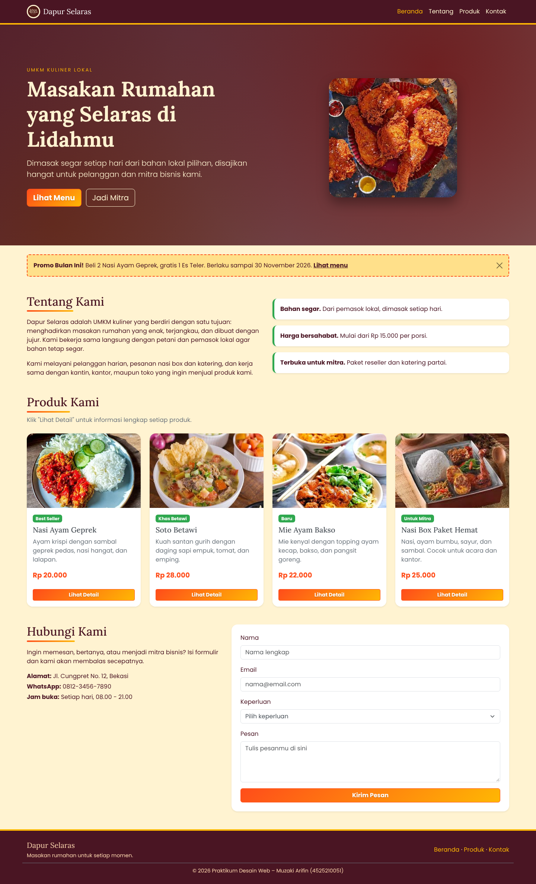
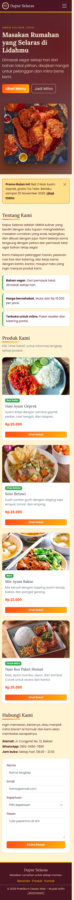
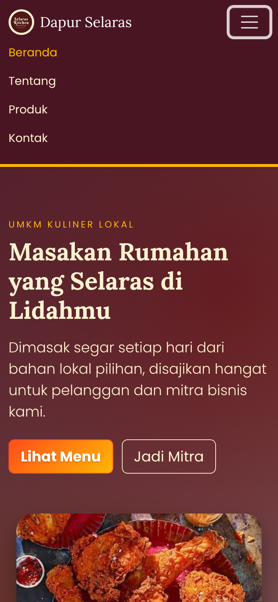
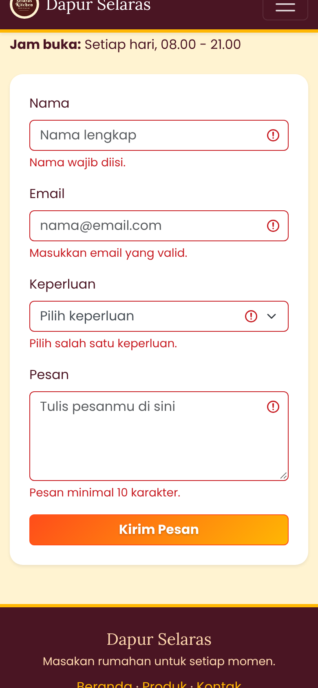
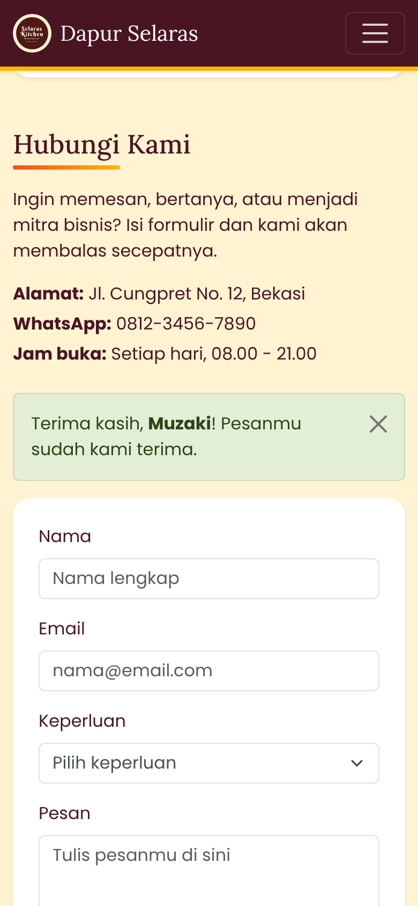

**Nama:** Muzaki Arifin<br>
**NPM:** 4525210051<br>
**Mata Kuliah:** Praktikum Desain Web<br>
**Kelas:** (A)<br>
**Dosen Pengampu:** Ari Wibowo, S.Kom., M.Kom., C. Pro

Praktikum Pertemuan 9 ini membahas *Bootstrap Grid System* (`container`, `row`, `column`, dan *breakpoint*) serta komponen Bootstrap 5.3.8 (Navbar, Card, Alert, Modal, Form). Tugasnya berupa halaman web **Dapur Selaras**, sebuah UMKM kuliner lokal, dengan branding sendiri yang ditulis di `css/style.css`. Halaman dirancang *mobile-first* sehingga tampilannya menyesuaikan layar HP maupun desktop.

## Struktur Proyek

```
Tugas/
├── README.md
├── index.html
├── css/
│   └── style.css
├── images/
│   ├── logo.png
│   ├── chicken.jpg
│   ├── ayam geprek.jpg
│   ├── soto.jpg
│   ├── mie ayam bakso.jpg
│   └── nasi box.jpg
└── screenshots/
    ├── 01-desktop-full.png
    ├── 02-mobile-full.png
    ├── 03-mobile-menu.png
    ├── 04-modal-produk.png
    ├── 05-validasi-form.png
    └── 06-form-sukses.png
```

## File index.html

Halaman memuat Bootstrap 5.3.8 dan Google Fonts (Playfair Display untuk judul, Poppins untuk teks) lewat CDN, lalu `css/style.css` untuk branding tambahan. Berikut bagian-bagiannya.

| Bagian | Komponen Bootstrap | Perilaku responsif |
|--------|--------------------|--------------------|
| Navbar | `navbar navbar-expand-lg sticky-top` | Menjadi tombol *hamburger* di bawah 992px |
| Hero | `row align-items-center` dengan `col-12 col-lg-6` | Teks dan gambar bertumpuk di HP, berdampingan di desktop |
| Promo | `alert alert-dismissible` | Dapat ditutup dengan tombol silang |
| Tentang Kami | `col-12 col-lg-6` | Teks di kiri, tiga kotak nilai di kanan pada layar lebar |
| Produk | `card` dalam `col-12 col-md-6 col-lg-3` | 1 kolom di HP, 2 kolom di tablet, 4 kolom di desktop |
| Detail produk | `modal modal-dialog-centered` | Isi modal diganti lewat atribut `data-*` pada tombol |
| Form kontak | `form-control`, `form-select`, `needs-validation` | Menjadi satu kolom penuh di HP |
| Footer | `row` dengan `text-center text-md-start` | Rata tengah di HP, rata kiri dan kanan di desktop |

Grid produk memakai tiga *breakpoint* sekaligus:

```html
<div class="col-12 col-md-6 col-lg-3">
    <div class="card card-produk h-100 shadow-sm">
        ...
    </div>
</div>
```

Kelas `h-100` membuat tinggi semua kartu sama walaupun panjang deskripsinya berbeda.

Ada dua potongan JavaScript di akhir halaman:

1. **Modal dinamis.** Saat tombol "Lihat Detail" diklik, event `show.bs.modal` membaca `data-nama`, `data-harga`, `data-deskripsi`, dan `data-gambar` dari tombol tersebut, lalu mengisinya ke dalam satu modal yang dipakai bersama oleh keempat produk.
2. **Validasi form.** Saat form dikirim, `checkValidity()` memeriksa semua kolom. Jika ada yang salah, pesan `invalid-feedback` ditampilkan. Jika semuanya benar, muncul alert sukses yang menyebut nama pengirim, lalu form dikosongkan.

## File css/style.css

### Sebelum

Palet awal berwarna cokelat tua dan krim kusam:

| Variabel | Nilai awal |
|----------|-----------|
| `--warna-gelap` | `#3a1a12` |
| `--warna-krim` | `#fff4e0` |
| `--warna-cabai` | `#d9481f` |
| `--warna-hijau` | `#5f7f3b` |

### Setelah

Warna dibuat lebih cerah dan hidup, dan ditambah satu warna aksen kunyit. Semua warna dipusatkan di `:root` sehingga cukup diubah di satu tempat.

| Variabel | Nilai baru | Keterangan |
|----------|-----------|------------|
| `--warna-gelap` | `#4a1523` | Maroon pekat untuk navbar, footer, dan teks |
| `--warna-krim` | `#fff3d1` | Latar halaman, krim kuning cerah |
| `--warna-cabai` | `#ff4d1a` | Warna utama tombol dan harga |
| `--warna-cabai-gelap` | `#e03a0c` | Warna tombol saat disorot |
| `--warna-hijau` | `#2fa84f` | Lencana dan garis kotak nilai |
| `--warna-kunyit` | `#ffb703` | Aksen baru untuk garis navbar, footer, dan gradasi |

Beberapa penyesuaian lain:

- Tombol `.btn-selaras` memakai gradasi cabai ke kunyit.
- Garis di bawah judul section dan latar hero ikut memakai gradasi dan cahaya radial berwarna kunyit.
- Navbar dan footer diberi garis kunyit setebal 4px.
- Kartu produk terangkat 6px saat disorot, dengan bayangan berwarna cabai.
- Logo diberi latar lingkaran krim (`.navbar-logo`) agar tetap terbaca di atas navbar yang gelap.

## Hasil

Halaman dibuka lewat `index.html` di peramban dan membutuhkan koneksi internet karena Bootstrap dan Google Fonts dimuat dari CDN.

### Tampilan Desktop (1440 px)



Pada layar lebar, hero tampil dua kolom, kartu produk berjajar empat, dan form kontak berada di sebelah kanan informasi alamat.

### Tampilan Mobile (390 px)



Pada layar HP semua bagian menumpuk menjadi satu kolom, tombol hero berjajar, dan kartu produk tampil satu per satu.

### Menu Hamburger di Mobile



Di bawah 992px, tautan navbar disembunyikan dan dibuka lewat tombol hamburger.

### Modal Detail Produk


Klik "Lihat Detail" pada Soto Betawi membuka modal berisi gambar, deskripsi, dan harga produk tersebut.

### Validasi Form Kontak



Jika form dikirim dalam keadaan kosong, setiap kolom yang belum valid menampilkan pesan kesalahan berwarna merah.

### Form Berhasil Dikirim



Jika semua kolom valid, muncul alert sukses yang menyapa pengirim berdasarkan nama yang diisi.
